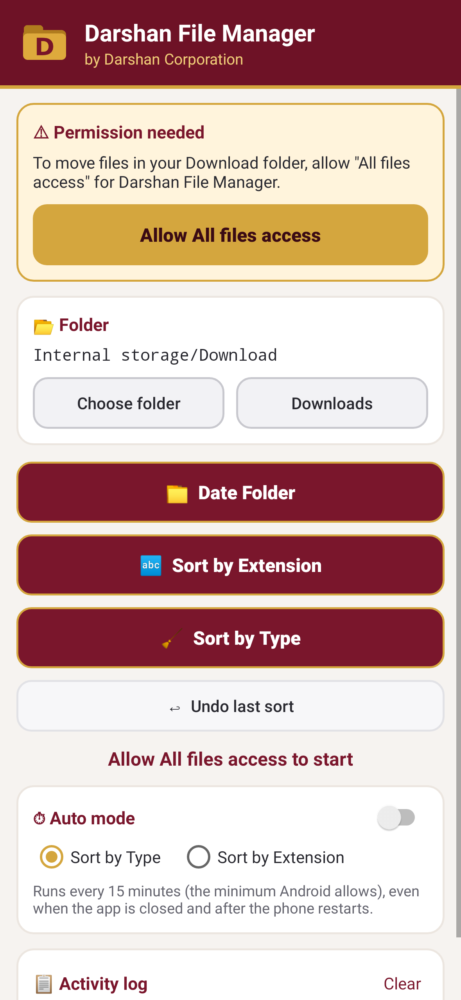
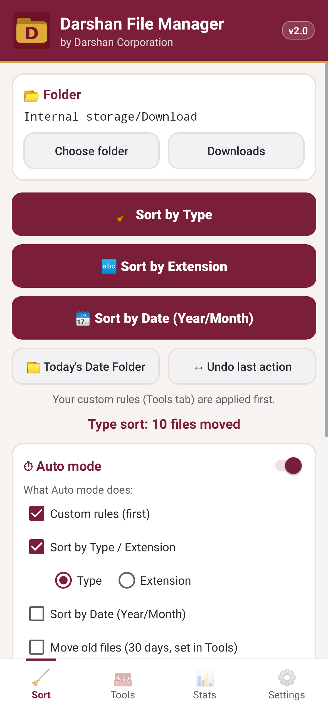

<p align="center">
  
</p>

<h1 align="center">Darshan File Manager for Android</h1>

<p align="center">
  A lightweight Android app that keeps your <b>Download</b> folder (or any folder) clean. Sort files by type or by extension, create date folders, undo any sort, and let <b>Auto mode</b> tidy up in the background, even after a restart.
</p>

<p align="center">
  
  
  
  
  
  
</p>

<p align="center">
  Also available for Windows 👉 <a href="https://github.com/DARSHAN-CROP/Darshan-File-Manager-Windows">Darshan File Manager (Windows)</a>
</p>

---

## ✨ Features

| | Feature | What it does |
|---|---|---|
| 🧹 | **Sort by Type** | Moves files into category folders: `Images`, `Videos`, `Music`, `PDF`, `Documents`, `Ebooks`, `Archives`, `Apps`, `Code`, `Fonts`, `Design`, `Contacts_Calendar`, `Torrents`, `Others`. Knows **400+ file extensions**. |
| 🔤 | **Sort by Extension** | One folder per extension: `JPG`, `PDF`, `MP4`, `APK`, … Double extensions like `.tar.gz` stay together. |
| 📁 | **Date Folder** | Creates a folder named with today's date (`DD-MM-YYYY`). |
| ↩ | **Undo last sort** | Moves every file back to where it was. |
| ⏱ | **Auto mode** | Sorts automatically every 15 minutes (the minimum Android allows), even when the app is closed and after the phone restarts. |
| 📂 | **Choose any folder** | Works on Download by default, or any folder in internal storage. |
| 📋 | **Activity log** | Shows what was moved and when. |

### Safe by design
- Never overwrites: duplicate names become `file (1).jpg`, `file (2).jpg`, …
- Skips files that are still downloading (`.crdownload`, `.part`, `.tmp`, …) and hidden files.
- No internet permission, no ads, no tracking. Everything stays on your phone.

---

## 📸 Screenshots

<p align="center">
  
  &nbsp;&nbsp;
  
</p>

---

## ⬇️ Download & Install

1. Download **[`DarshanFileManager.apk`](release/DarshanFileManager.apk)** (about 110 KB) on your phone, or get it from the [latest release](../../releases/latest).
2. Open the file. If Android asks, allow **Install unknown apps** for your browser or file manager.
3. Open the app and tap **Allow All files access**, then turn the switch **ON** for Darshan File Manager.
4. Tap **Sort by Type** and you're done.

> On Android 7 to 10 the app asks for the normal storage permission instead of All files access.

---

## 🛠 Build from source

**Requirements:** JDK 17, Android SDK (platform 34, build-tools 34.0.0)

### With Gradle / Android Studio
Open the project in Android Studio, or run:
```bash
./gradlew assembleRelease
```
To sign a release build, copy `keystore.properties.example` to `keystore.properties` and fill in your own keystore details. Without it, the build is signed with the debug key.

### Without Gradle (command line)
```bash
export ANDROID_HOME=~/Android/Sdk
export KS_PASS=your_keystore_password
./build.sh
```

### Run the unit tests
```bash
./gradlew test
```
Tests use JUnit 4 and Robolectric and cover the sorting rules, undo, and the main screen.

---

## 📂 Project structure

```
Darshan-File-Manager-Android/
├── app/
│   ├── build.gradle
│   └── src/
│       ├── main/
│       │   ├── AndroidManifest.xml
│       │   ├── java/com/darshan/filemanager/
│       │   │   ├── MainActivity.java   # UI, permissions, buttons, log
│       │   │   ├── Sorter.java         # sort by type / extension, date folder, undo
│       │   │   ├── AutoSortJob.java    # background Auto mode (JobScheduler)
│       │   │   └── Store.java          # settings and undo history
│       │   └── res/                    # layout, colours, icons
│       └── test/                       # JUnit + Robolectric tests
├── release/DarshanFileManager.apk
├── screenshots/
├── build.sh                            # Gradle-free build script
├── build.gradle · settings.gradle · gradlew
└── README.md
```

---

## 🔐 Permissions

| Permission | Why |
|---|---|
| `MANAGE_EXTERNAL_STORAGE` (Android 11+) | To move files inside Download and other folders |
| `READ/WRITE_EXTERNAL_STORAGE` (Android 7 to 10) | Same, on older Android versions |
| `RECEIVE_BOOT_COMPLETED` | To keep Auto mode running after a restart |

This app is meant to be sideloaded. Google Play limits the All files access permission.

---

## 👤 Author

**Darshankumar Savsani** · *Darshan Corporation*
Diploma in Computer Engineering, Atmiya University, Rajkot

- Organization: [DARSHAN CROP](https://github.com/DARSHAN-CROP)
- GitHub: [@1darshankumarsavsani-blip](https://github.com/1darshankumarsavsani-blip)
- Email: 1darshankumarsavsani@gmail.com

If you find it useful, please ⭐ star the repo!

## 📄 License

Released under the [MIT License](LICENSE).
