<p align="center">
  
</p>

<h1 align="center">Darshan File Manager for Android</h1>

<p align="center">
  A lightweight Android app that keeps your <b>Download</b> folder (or any folder) clean. Sort by type, extension or date, write your own rules, find duplicates, clear out old files, rename in bulk, see what takes space, and let <b>Auto mode</b> do it all in the background. Light / Dark theme, 6 app colours, English and ગુજરાતી.
</p>

<p align="center">
  
  
  
  
  
  
</p>

<p align="center">
  Also available for Windows 👉 <a href="https://github.com/DARSHAN-CROP/Darshan-File-Manager-Windows">Darshan File Manager (Windows)</a>
</p>

---

## ✨ Features

### 🆕 New in 2.0
| | Feature | What it does |
|---|---|---|
| 🎨 | **Theme + App color** | Light, Dark or System (follows your phone). Pick the app colour: Maroon, Gold, Blue, Green, Purple or Orange. Text is contrast-checked in every combination. |
| 👯 | **Duplicate file finder** | Finds files with exactly the same content (size, then MD5), shows each group and the wasted space. Tick the copies you don't need and they move to a `Duplicates` folder. Never deleted. |
| 📌 | **Custom rules** | Your own rules run first: `.jpg .png → Photos`, or *name contains* `invoice` → `Bills`. Add, edit, delete any time. |
| 🗄 | **Old files cleaner** | Files not changed for 30 / 60 / 90 days (or your own number) move to `Old Files`. Preview first. |
| 🗓 | **Sort by Date** | Year / Month folders by modified date, e.g. `2026/11-November`. |
| 📊 | **Storage usage** | Size and file count for every category, as a bar chart. |
| ✏ | **Batch rename** | Filter by name or extension, then prefix / suffix, find → replace, or numbering like `Photo_001`. Preview before renaming. |
| 🌐 | **English / ગુજરાતી** | Every screen in both languages, switches instantly. |
| 🔔 | **Notifications** | After Auto mode: *"12 sorted, 3 duplicates moved, 5 old files moved"*. Optional after a manual sort too. |
| ⏱ | **Smarter Auto mode** | Tick what Auto mode does: custom rules, type/extension sort, date sort, old files, duplicates. |

### Everything from 1.0
| | Feature | What it does |
|---|---|---|
| 🧹 | **Sort by Type** | Moves files into category folders: `Images`, `Videos`, `Music`, `PDF`, `Documents`, `Ebooks`, `Archives`, `Apps`, `Code`, `Fonts`, `Design`, `Contacts_Calendar`, `Torrents`, `Others`. Knows **400+ file extensions**. |
| 🔤 | **Sort by Extension** | One folder per extension: `JPG`, `PDF`, `MP4`, `APK`, … Double extensions like `.tar.gz` stay together. |
| 📁 | **Date Folder** | Creates a folder named with today's date (`DD-MM-YYYY`). |
| ↩ | **Undo last action** | Every sort, duplicate move, old-files move and rename can be undone. |
| ⏱ | **Auto mode** | Runs every 15 minutes (the minimum Android allows), even when the app is closed and after the phone restarts. |
| 📂 | **Choose any folder** | Works on Download by default, or any folder in internal storage. |
| 📋 | **Activity log** | Shows what was moved and when. |

### Safe by design
- Never deletes and never overwrites: duplicate names become `file (1).jpg`, `file (2).jpg`, …
- Skips files that are still downloading (`.crdownload`, `.part`, `.tmp`, …) and hidden files.
- No internet permission, no ads, no tracking. Everything stays on your phone.

---

## 📸 Screenshots

The app has four sections at the bottom: **Sort · Tools · Stats · Settings**.

| | Light | Dark |
|---|---|---|
| 🧹 Sort | 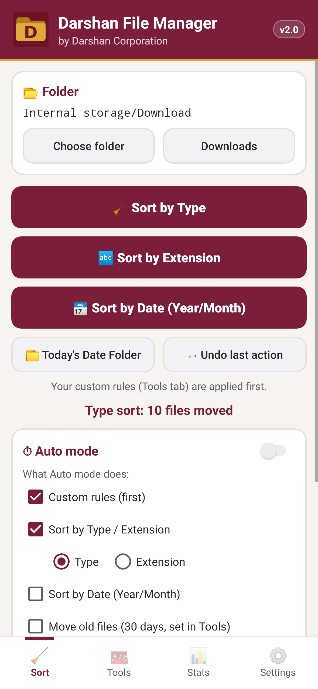 | 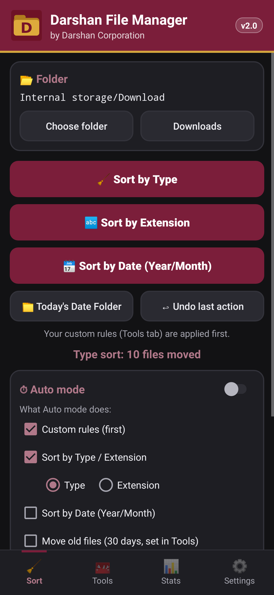 |
| 🧰 Tools: rules + duplicates | 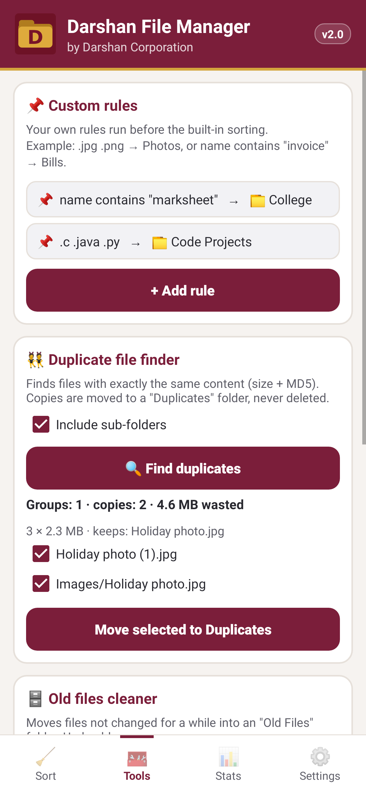 | 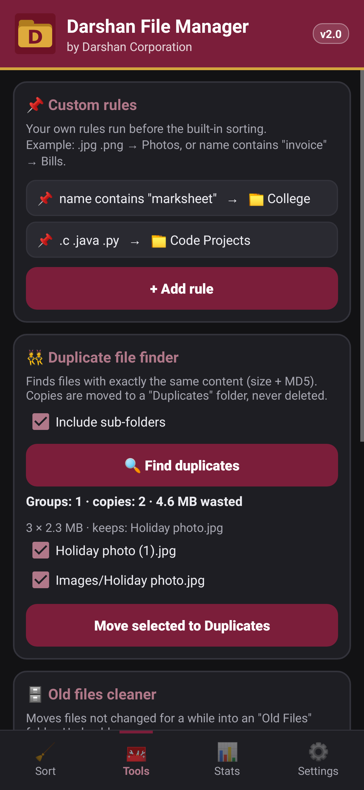 |
| 🧰 Tools: old files + rename | 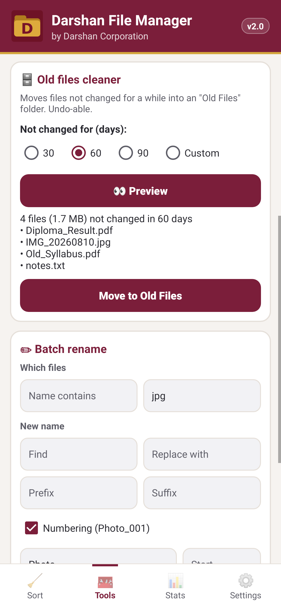 | 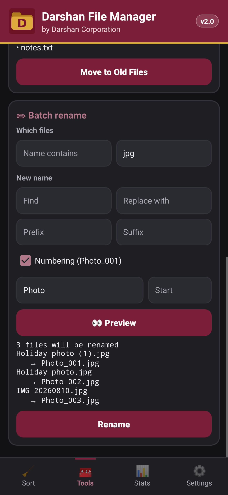 |
| 📊 Stats | 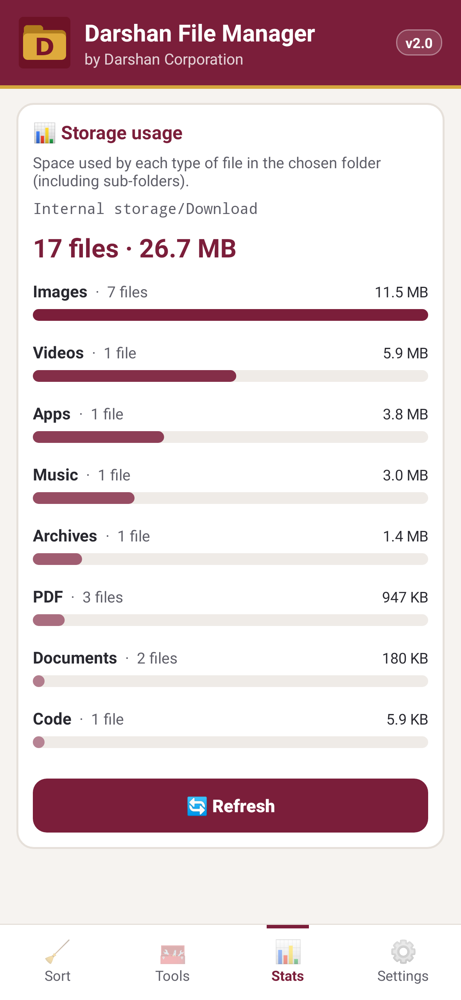 | 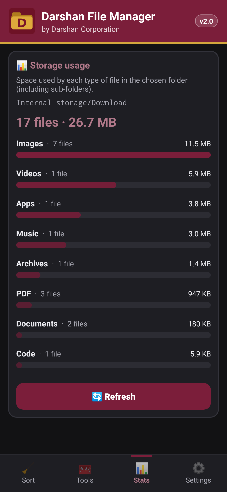 |
| ⚙️ Settings | 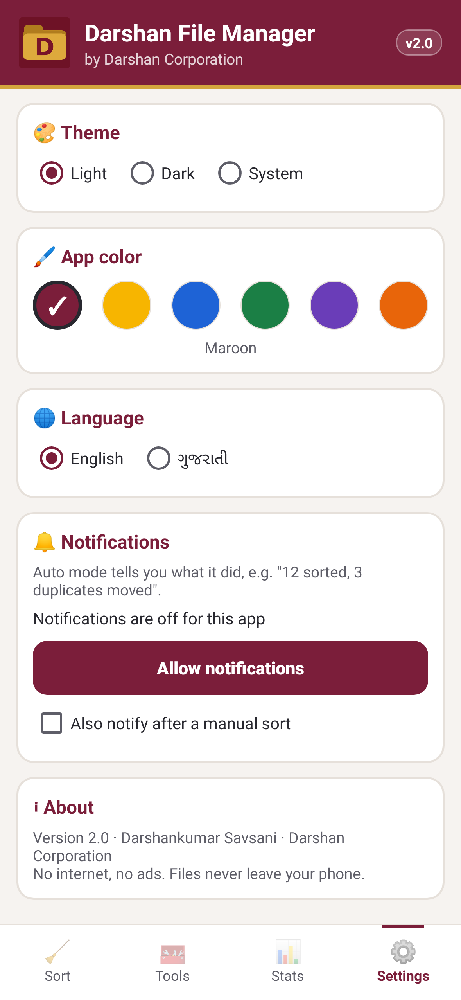 | 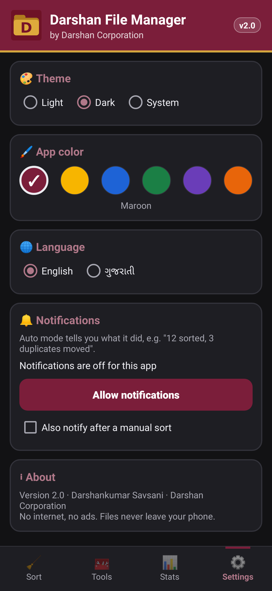 |

**ગુજરાતી** and other app colours:

<p align="center">
  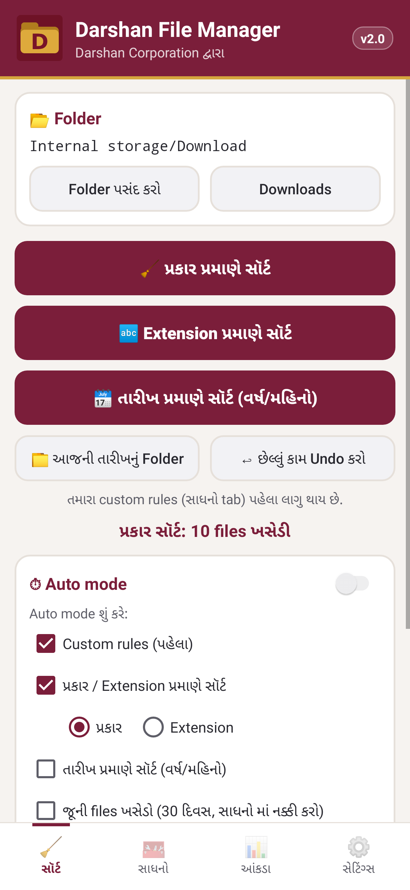
  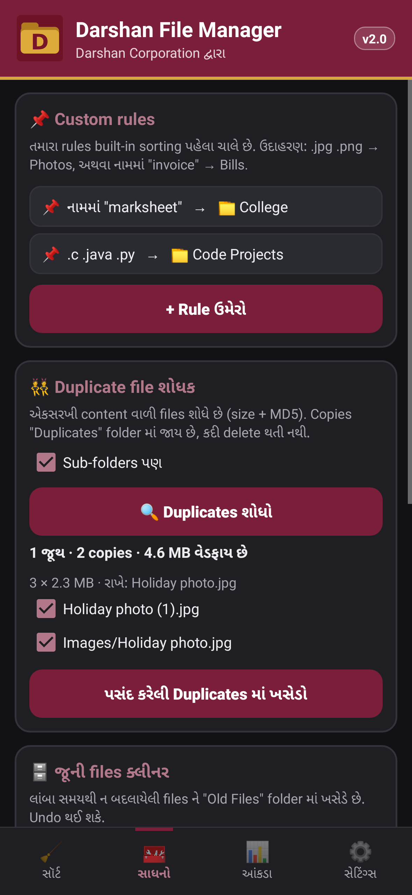
  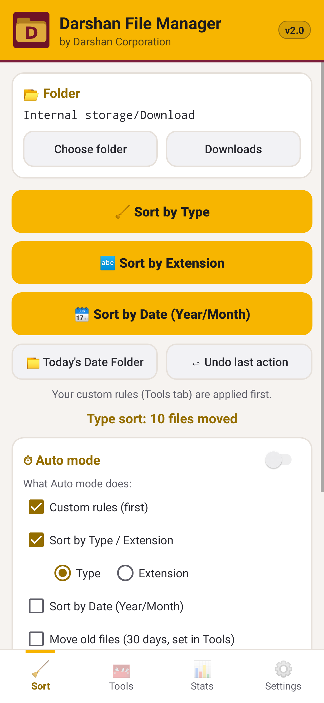
  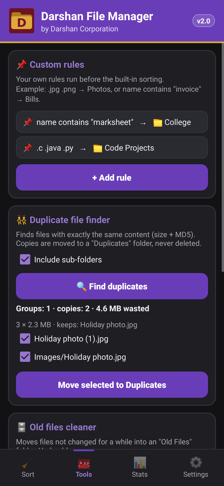
</p>

---

## ⬇️ Download & Install

1. Download **[`DarshanFileManager.apk`](release/DarshanFileManager.apk)** (about 170 KB) on your phone, or get it from the [latest release](../../releases/latest).
2. Open the file. If Android asks, allow **Install unknown apps** for your browser or file manager.
3. Open the app and tap **Allow All files access**, then turn the switch **ON** for Darshan File Manager.
4. Tap **Sort by Type** and you're done.
5. Updating from 1.0? Just install over it: your settings stay.

> On Android 7 to 10 the app asks for the normal storage permission instead of All files access.

---

## 🛠 Build from source

**Requirements:** JDK 17, Android SDK (platform 34, build-tools 34.0.0)

### With Gradle / Android Studio
Open the project in Android Studio, or run:
```bash
./gradlew assembleRelease
```
To sign a release build, copy `keystore.properties.example` to `keystore.properties` and fill in your own keystore details. Without it, the build is signed with the debug key.

### Without Gradle (command line)
```bash
export ANDROID_HOME=~/Android/Sdk
export KS_PASS=your_keystore_password
./build.sh
```

### Run the unit tests
```bash
./gradlew test
```
Tests use JUnit 4 and Robolectric: **72 tests** covering sorting, undo, custom rules, duplicates, old files, date folders, batch rename, storage totals, theme contrast, language switch, Auto mode and notifications. The same run renders the screenshots in `screenshots/`.

---

## 📂 Project structure

```
Darshan-File-Manager-Android/
├── app/
│   ├── build.gradle
│   └── src/
│       ├── main/
│       │   ├── AndroidManifest.xml
│       │   ├── java/com/darshan/filemanager/
│       │   │   ├── MainActivity.java   # UI: 4 tabs, dialogs, permissions
│       │   │   ├── Sorter.java         # sort by type / extension / date, undo
│       │   │   ├── Rules.java          # custom rules
│       │   │   ├── Duplicates.java     # duplicate finder (size + MD5)
│       │   │   ├── OldFiles.java       # old files cleaner
│       │   │   ├── Renamer.java        # batch rename
│       │   │   ├── Storage.java        # storage usage per category
│       │   │   ├── AutoRunner.java     # what Auto mode runs, and its summary
│       │   │   ├── Palette.java        # theme + app colours, contrast maths
│       │   │   ├── UiTheme.java · BarChartView.java · Lang.java · Notifier.java
│       │   │   ├── AutoSortJob.java    # background Auto mode (JobScheduler)
│       │   │   └── Store.java          # settings and undo history
│       │   └── res/                    # layout, strings (English + values-gu), icons
│       └── test/                       # JUnit + Robolectric tests
├── release/DarshanFileManager.apk
├── screenshots/
├── build.sh                            # Gradle-free build script
├── build.gradle · settings.gradle · gradlew
├── CHANGELOG.md
└── README.md
```

---

## 🔐 Permissions

| Permission | Why |
|---|---|
| `MANAGE_EXTERNAL_STORAGE` (Android 11+) | To move files inside Download and other folders |
| `READ/WRITE_EXTERNAL_STORAGE` (Android 7 to 10) | Same, on older Android versions |
| `RECEIVE_BOOT_COMPLETED` | To keep Auto mode running after a restart |
| `POST_NOTIFICATIONS` (Android 13+) | To tell you what Auto mode did (optional) |

This app is meant to be sideloaded. Google Play limits the All files access permission.

---

## 👤 Author

**Darshankumar Savsani** · *Darshan Corporation*
Diploma in Computer Engineering, Atmiya University, Rajkot

- GitHub: [@1darshankumarsavsani-blip](https://github.com/1darshankumarsavsani-blip)
- Email: 1darshankumarsavsani@gmail.com
- Organization: [DARSHAN CROP](https://github.com/DARSHAN-CROP)

If you find it useful, please ⭐ star the repo!

## 📄 License

Released under the [MIT License](LICENSE).
